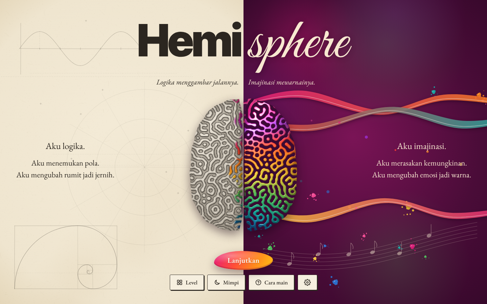
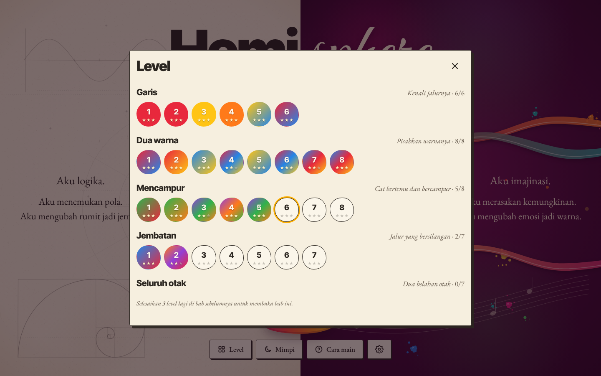
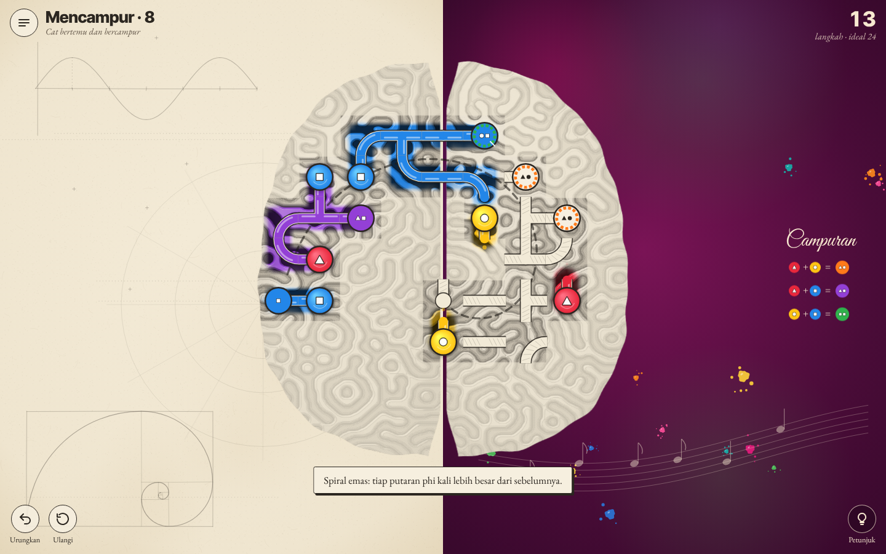
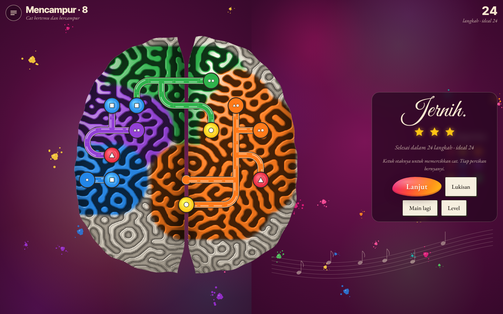
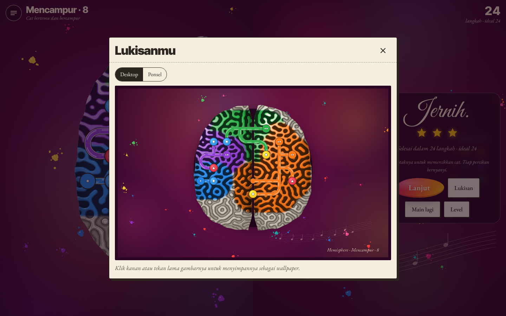
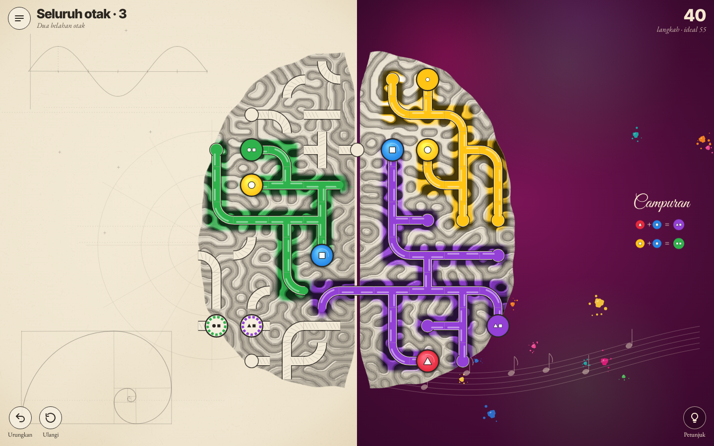
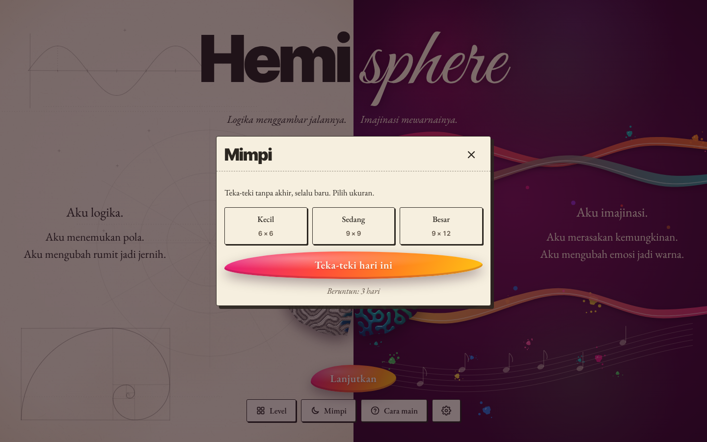
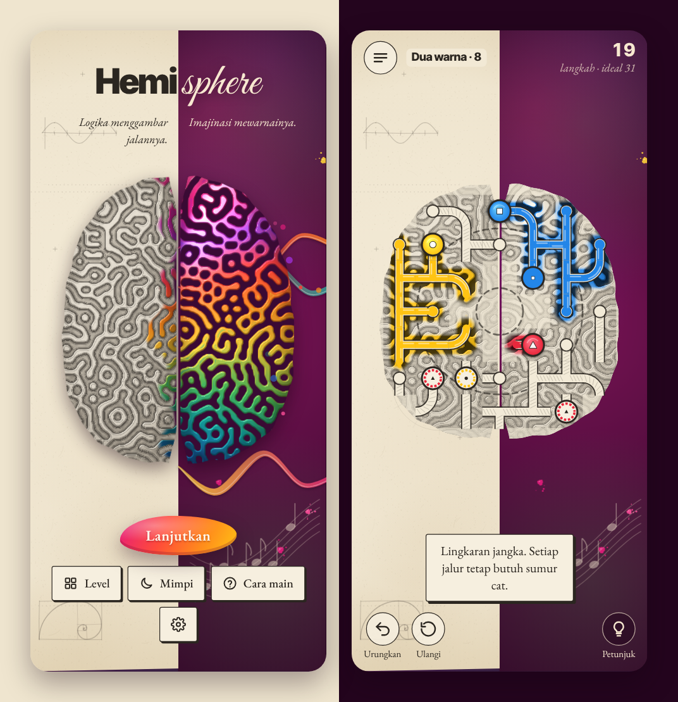

# Hemisphere

Game puzzle berbentuk otak yang bisa langsung dimainkan di browser. Idenya dari wallpaper otak kiri dan otak kanan: belahan kiri itu logika, digambar pakai sketsa pensil di atas kertas, sedangkan belahan kanan itu imajinasi yang penuh warna.

Cara mainnya, putar ubin jalur yang masih berupa sketsa pensil supaya cat mengalir dari sumur cat ke setiap lingkaran pikiran. Cat bercampur kalau jalurnya ketemu: merah + kuning jadi oranye, kuning + biru jadi hijau, merah + biru jadi ungu, dan kalau ketiganya ketemu jadinya lumpur. Begitu level selesai, otaknya mekar penuh warna, dan hasilnya bisa disimpan jadi wallpaper.

Gamenya nggak pakai framework. Kodenya ditulis sebagai modul JavaScript di folder `src`, lalu digabung jadi satu file `index.html` pakai esbuild.

Link game: https://yahya-nz.github.io/Game-Hemisphere/

## Tampilan

**Layar Judul**

Layar judulnya dibelah dua kayak wallpaper aslinya. Kiri itu logika, dengan gambar gelombang sinus, lingkaran jangka, dan spiral emas dari pensil. Kanan itu imajinasi, dengan cipratan cat, pita warna, dan not musik.



**Pilih Level**

36 level dalam 5 bab: Garis, Dua warna, Mencampur, Jembatan, dan Seluruh otak. Bab berikutnya kebuka setelah minimal 60% level di bab sebelumnya selesai.



**Main**

Ketuk ubin buat memutarnya. Cat langsung mengalir lewat jalur yang tersambung, dan contekan campuran warnanya ada di sebelah kanan. Beberapa papan dipotong berbentuk gelombang sinus, lingkaran jangka, atau spiral emas, kayak level spiral di bawah ini.



**Level Selesai**

Kalau semua lingkaran sudah dapat warnanya, nggak ada cat yang bocor, dan semua jalur sudah berwarna, otaknya mekar penuh warna. Bintangnya dihitung dari jumlah langkah dibanding langkah ideal. Otaknya juga bisa diketuk buat memercikkan cat, dan tiap percikan bunyi nada.



**Lukisan**

Otak yang sudah berwarna bisa dijadikan wallpaper ukuran desktop atau HP. Klik kanan atau tekan lama gambarnya buat menyimpan.



**Seluruh Otak**

Di bab terakhir papannya berbentuk otak utuh, dan dua belahannya cuma bersentuhan di beberapa tempat.



**Mimpi**

Teka-teki baru tanpa batas dalam tiga ukuran, plus satu teka-teki harian. Teka-teki harian sama untuk semua orang di tanggal yang sama, dan kalau dimainkan tiap hari hitungan beruntunnya naik.



**Tampilan di HP**

Kiri: layar judul. Kanan: bab Dua warna, papannya berbentuk lingkaran jangka.



## Fitur

- 36 level dalam 5 bab, mulai dari tutorial di bab Garis sampai papan berbentuk otak utuh.
- Semua level pasti bisa diselesaikan: papannya dibuat dari jalur yang sudah tersambung, baru ubinnya diacak.
- Campur warna: merah + kuning = oranye, kuning + biru = hijau, merah + biru = ungu, dan ketiganya jadi lumpur.
- Jembatan bikin dua jalur bisa bersilangan tanpa bercampur. Ubin yang dipaku sudah di posisi yang benar dan nggak bisa diputar.
- Hitungan langkah dan langkah ideal, sampai 3 bintang per level. Kalau pakai petunjuk, bintangnya maksimal 2.
- Tombol Urungkan, Ulangi, dan Petunjuk.
- Mode Mimpi: teka-teki acak tanpa batas ukuran 6×6, 9×9, dan 9×12, plus teka-teki harian dengan hitungan beruntun.
- Lukisan: simpan otak yang sudah berwarna jadi wallpaper desktop atau HP.
- Musik dan efek suara dibuat langsung oleh kode: bunyi goresan pensil waktu ubin diputar, dan tiap warna cat punya nadanya sendiri.
- Bahasa Indonesia dan Inggris. Bahasanya dipilih otomatis dari bahasa browser atau zona waktu Indonesia, dan bisa diganti di Pengaturan.
- Pengaturan: efek suara, musik, simbol warna di jalur (▲ merah, ● kuning, ■ biru) buat yang susah bedain warna, kurangi animasi, dan hapus progres.
- Bisa dimainkan pakai mouse, layar sentuh, atau keyboard saja.
- Progres disimpan di browser.

## Teknologi

- HTML, CSS, dan JavaScript (modul ES) tanpa framework.
- esbuild buat menggabungkan semua modul jadi satu file `index.html`.
- Canvas 2D buat papan, otak, dan latarnya. Lipatan otaknya dibuat dengan rumus (pola mirip motif Turing), jadi nggak ada file gambar sama sekali.
- Web Audio API buat musik dan efek suara.
- Font EB Garamond, Great Vibes, dan Inter Tight dari Google Fonts.
- Tes pakai `node --test` dan Playwright.

## Struktur folder

```text
.
├── index.html            game siap main, hasil build (file ini yang dibuka GitHub Pages)
├── package.json          perintah build dan tes
├── src
│   ├── shell.html        kerangka halaman: judul, font, dan tempat game
│   ├── style.css         tampilan layar judul, HUD, panel, dan tombol
│   ├── main.js           mulai game, alur layar, input, suara, dan simpan progres
│   ├── app
│   │   ├── scene.js      kanvas: papan, otak, latar, percikan cat, dan lukisan
│   │   ├── strings.js    semua teks bahasa Indonesia dan Inggris
│   │   └── ui.js         layar judul, HUD, panel, dan kartu level selesai
│   ├── game
│   │   ├── engine.js     ubin, putaran, aliran cat, kebocoran, dan cek menang
│   │   ├── generator.js  pembuat papan acak yang pasti bisa diselesaikan
│   │   ├── levels.js     daftar bab dan level, mode Mimpi, dan teka-teki harian
│   │   ├── session.js    langkah, urungkan, petunjuk, bintang, dan waktu aliran cat
│   │   ├── view.js       gambar ubin dan jalur
│   │   └── brainboard.js otak yang menyerap cat
│   └── lib
│       ├── audio.js      musik dan efek suara
│       ├── backdrop.js   latar kertas, dunia cat ungu, pita, dan garis not
│       ├── brainart.js   lipatan otak versi pensil dan versi cat
│       ├── i18n.js       pilih bahasa dan isi teks
│       ├── rng.js        angka acak dengan seed, hasilnya sama di semua perangkat
│       └── store.js      penyimpanan di browser
├── tests
│   ├── unit              tes aturan main, semua level, sesi, dan penyimpanan
│   └── e2e               tes Playwright di ukuran laptop dan HP
├── tools
│   ├── build.mjs         gabungkan src jadi index.html (plus dist/ untuk versi claude.ai)
│   ├── screens.mjs       screenshot semua panel di laptop dan HP
│   └── smoke.mjs         cek cepat error dan tampilan di laptop dan HP
└── screenshot
```

## Cara menjalankan

1. Clone atau download repo ini.
2. Buka file `index.html` di browser (Chrome, Firefox, Edge, atau Safari). Semua kode game sudah ada di dalam file itu.
3. Pastikan konek internet, soalnya fontnya diambil dari Google Fonts. Kalau offline gamenya tetap jalan, cuma tulisannya pakai font bawaan browser.
4. Suara dan musik baru keluar setelah layar diketuk atau diklik. Bisa dimatikan lewat ikon gerigi di layar judul.

Kalau mau ngubah kodenya, pasang Node.js dulu, lalu:

```bash
npm install
```

```bash
npm run build
```

```bash
npm test
```

`npm run build` bikin ulang `index.html` dari folder `src`, dan `npm test` ngetes aturan main, semua level, sesi, dan penyimpanan. Buat tes Playwright (klik dan ketuk sungguhan di ukuran laptop dan HP), pasang browsernya sekali, lalu jalankan `npm run e2e`:

```bash
npx playwright install chromium
```

```bash
npm run e2e
```

## Cara main

| Aksi | Laptop | HP |
|---|---|---|
| Putar ubin searah jarum jam | Klik ubinnya, atau `Spasi` / `Enter` | Ketuk ubinnya |
| Putar ubin ke arah sebaliknya | Klik kanan ubinnya, atau `Shift` + `Spasi` | Tekan lama ubinnya |
| Pindah ubin pakai keyboard | Tanda panah | - |
| Urungkan | `Z` atau `Backspace` | Tombol Urungkan |
| Petunjuk | `H` | Tombol Petunjuk |
| Ulangi level | `R` | Tombol Ulangi |
| Buka menu | `Esc` | Tombol menu di kiri atas |
| Simpan lukisan | Klik kanan gambarnya | Tekan lama gambarnya |

## Mengubah isi

- Daftar bab dan level ada di `src/game/levels.js`, bagian `CHAPTERS`. Level tutorial di bab Garis digambar manual di bagian `TUTORIAL`, sisanya dibuat generator dengan seed tetap.
- Ukuran papan mode Mimpi ada di `src/game/levels.js`, bagian `DREAM_SIZES`.
- Semua teks bahasa Indonesia dan Inggris ada di `src/app/strings.js`.
- Warna cat ada di `src/game/engine.js`: `RED`, `YELLOW`, dan `BLUE`. Warna campuran didapat dari gabungan ketiganya, dan namanya ada di `COLOR_NAMES`.
- Rumus bintang ada di `src/game/session.js`, fungsi `starsFor`.
- Nada tiap warna cat ada di `src/main.js`, bagian `NOTE_FOR`.
- Setelah mengubah file di `src`, jalankan `npm run build` supaya `index.html` ikut berubah.
